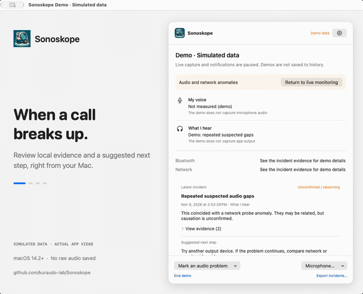

  

# Sonoskope

**Investigate meeting audio issues from your Mac menu bar.**

English | [简体中文](README_zh.md)

“Can you hear me?” “Your audio keeps cutting out.” Sonoskope helps you look for local clues when a call goes wrong: microphone levels, changes to your audio devices, and network events, together in one native Mac app.

[**Download for Mac →**](https://github.com/kuraudo-lab/Sonoskope/releases) · [Report a problem](https://github.com/kuraudo-lab/Sonoskope/issues) · [Monitoring reference](docs/monitoring.md)

macOS 14.2+ · Apple Silicon & Intel · English & 简体中文

> **Developer preview:** current downloads are ad-hoc signed and not notarized by Apple. macOS may block first launch; the PKG installer is also unsigned. Physical-device coverage is still growing—see the [validation record](docs/validation.md).

## See what happened when the sound broke up

*Actual Sonoskope interface with simulated data. Demo scenarios pause live collectors and do not send notifications or save incidents to your live history.*

Four scenes, about two seconds each. [View the full-size interface screenshot →](assets/demo/status-en.png)

## A clearer starting point for troubleshooting

| When you wonder… | Sonoskope helps you… |
| --- | --- |
| “Is my microphone picking up sound?” | View local input levels with a 10-second test or opt-in automatic monitoring. See which apps are using the monitored microphone. |
| “Did my headphones disconnect?” | Review system-visible device changes and disconnect evidence. Read Bluetooth signal strength where available. |
| “Did the network change at the same time?” | Compare audio-level history with network-path events and lightweight connection probes. |
| “What should I check next?” | Open an incident to read its evidence, what remains uncertain, and a suggested next step. Export a diagnostic report for follow-up. |

No extra audio driver or meeting-platform integration is required. Sonoskope uses public macOS APIs and does not reroute your sound.

## Download and get started

1. **Install.** Open [Releases](https://github.com/kuraudo-lab/Sonoskope/releases), choose `arm64` for Apple Silicon or `x86_64` for Intel, and download the DMG. Drag Sonoskope to Applications, eject the disk image, then launch it from Applications. PKG and ZIP downloads are also available. Quit the old version before updating.
2. **Choose what to observe.** Click the Sonoskope menu-bar icon to open status, then the gear to open Settings. Device and network-path monitoring start automatically. Enable output analysis to see app-output levels, or opt into automatic microphone monitoring. Grant the relevant macOS permission when prompted.
3. **Check the evidence.** When audio breaks up, use the button for marking a sound problem to record the moment. Review recent incidents and the last 60 seconds of charts. A blank reading means data is unavailable, not that the sound is healthy.

Prefer a quick input check? Use the microphone menu to start a bounded **10-second test**. Automatic microphone monitoring follows other apps' input-device usage; a meeting's mute button may leave that usage active. Opening the microphone can change a Bluetooth headset's mode.

Closing the window keeps monitoring running. Pause from the status window, or right-click the menu-bar icon to quit. You can explore the built-in demo scenarios from Settings without making a call.

## Keep the clues, without saving raw audio

- **No raw audio is saved.** Audio analysis produces numeric measurements; retained history contains diagnostic events and metrics.
- **You control capture.** Microphone and app-output analysis are opt-in. Automatic microphone capture stops when other apps release the input and suspends on pause, sleep, demos, unknown usage, or lost permission.
- **History stays local.** Keep up to 100 incidents for the current session, 24 hours, or 7 days. Exported JSON can contain app/device identifiers and timestamps; review it before sharing.
- **Network checks are explicit.** Optional probes connect to `www.apple.com:443` while measured audio is active. They send no audio and can be disabled in Settings.

## Understand the limits

Sonoskope provides **local evidence and possible explanations**, not an end-to-end call-quality score. Local microphone levels cannot tell you what another participant heard; app-output levels cannot prove what your headset played. Network probes are not the meeting's latency or packet-loss measurements. Events occurring together do not prove a cause.

Missing data, collector failures, and suspected causes are shown separately. [Read the full monitoring and privacy details →](docs/monitoring.md)

## Help shape the preview

[Open an issue](https://github.com/kuraudo-lab/Sonoskope/issues) with your macOS version, Sonoskope version, audio device, and what you expected to see. Include a reviewed diagnostic export if useful—no meeting recording is needed. Feedback on installation, unclear messages, and false alarms is especially helpful.

For contributors: [Build and run](docs/development.md) · [Architecture](docs/architecture.md) · [Product contract](docs/product.md) · [Tests and validation](docs/validation.md) · [Release process](docs/releasing.md)
