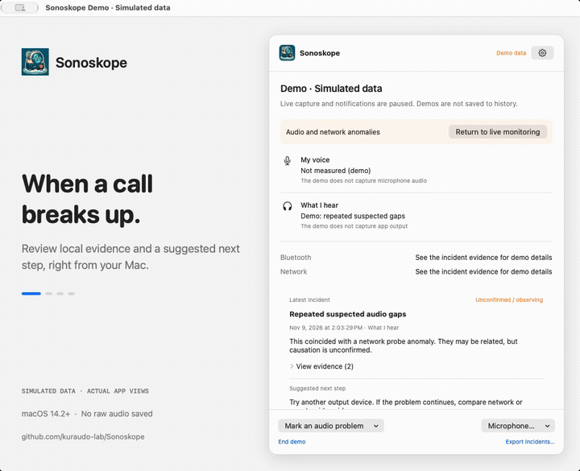

  

# Sonoskope

**会议声音断断续续？从 Mac 菜单栏开始排查。**

[English](README.md) | 简体中文

「能听到我吗？」「你刚才的声音又断了。」Sonoskope 将麦克风电平、音频设备变化和网络事件放在同一个原生 Mac 界面里，帮助你在通话出问题时找到本机可见的线索。

[**下载 Mac 版 →**](https://github.com/kuraudo-lab/Sonoskope/releases) · [反馈问题](https://github.com/kuraudo-lab/Sonoskope/issues) · [监测详细说明（英文）](docs/monitoring.md)

macOS 14.2+ · Apple Silicon 与 Intel · 中文与英文界面

> **0.3.1 预览版：**Apple Silicon 与 Intel 下载包均已使用 Developer ID 签名并通过 Apple 公证。真实设备验证仍在完善，具体范围见[验证记录](docs/validation.md)。

## 看看声音中断前后发生了什么

*真实应用界面，使用模拟数据。演示期间暂停实时采集，不发送系统通知，也不写入真实问题历史。*

8 秒循环演示，每约 2 秒切换一个场景。[查看中文界面大图 →](assets/demo/status-zh.png)

## 让排查有一个清晰的起点

| 你想知道…… | Sonoskope 可以帮助你…… |
| --- | --- |
| 「麦克风有收到声音吗？」 | 通过十秒测试或主动开启的自动监测查看本地输入电平，并了解哪些应用正在使用被监测的麦克风。 |
| 「是不是耳机断开了？」 | 回看系统可见的设备变化和断连证据，在支持时查看蓝牙信号强度。 |
| 「网络是不是也在那时出了变化？」 | 对照声音电平历史、网络路径变化和轻量连接探测。 |
| 「接下来应该查什么？」 | 打开问题记录，查看依据、尚不能确定的部分及下一步建议；需要时导出诊断报告。 |

无需额外音频驱动，也无需接入会议平台。Sonoskope 使用公开 macOS 接口，不改变声音的输出路径。

## 下载后，三步开始

1. **安装应用。**前往[下载页](https://github.com/kuraudo-lab/Sonoskope/releases)，Apple Silicon 选择 `arm64`，Intel 选择 `x86_64`。下载并打开 DMG，将 Sonoskope 拖入 Applications，推出磁盘映像后从「应用程序」启动。也提供 PKG 和 ZIP。从 0.1.6 或更早版本升级时，请退出旧版，手动安装一次 0.3.1。
2. **选择监测内容。**首次启动的三步引导会介绍菜单栏应用并让你选择采集范围；可跳过，也可随时重新打开。设备和网络路径监测会自动开始。需要声音曲线时，可开启输出音频分析或自动麦克风监测，并按提示授予相应系统权限。
3. **出问题时查看证据。**点击「刚才声音有问题」标记时间点，在「概览」查看当前状态，在「趋势」对照最近六十秒图表，在「问题」回看历史证据。读数为空表示没有可用数据，不代表声音正常。

只想快速检查麦克风？从麦克风菜单启动 **10 秒测试**即可。自动监测跟随其他应用对输入设备的使用；会议中按下静音后，应用仍可能占用麦克风。打开麦克风可能改变蓝牙耳机的工作模式。

关闭窗口后仍会继续监测。可在状态窗口暂停，或右键点击菜单栏图标退出。无需发起通话，就能在设置中体验内置演示场景。

## 更新由你安排

Sonoskope 会在后台检查新版本、下载并验证更新包。准备好后点击「安装并重启」即可；普通退出不会安装更新。可在设置中关闭自动检查。[更新机制说明（英文）→](docs/updating.md)

## 保留诊断线索，不保存原始音频

- **不保存原始录音。**音频分析产生数值指标，历史仅保留诊断事件和指标。
- **采集由你决定。**麦克风和应用输出分析均需主动开启。自动麦克风采集在其他应用释放输入后停止，并在暂停、睡眠、演示、无法确认使用状态或失去权限时停止。
- **历史保存在本机。**最多保留一百条问题，可选择仅当前运行、二十四小时或七天。导出的 JSON 可能包含应用和设备标识、时间戳，分享前请检查。
- **软件更新检查**会连接 GitHub，不发送音频或诊断历史，可在设置中关闭。
- **网络探测可关闭。**可选探测在采集到活跃声音电平时连接 `www.apple.com:443`，不发送音频，可在设置中关闭。

## 它能告诉你什么，哪些还不能确定

Sonoskope 提供的是**本机证据和可能的解释**，不提供整条通话链路的音质评分。本地麦克风电平无法判断对方实际听到了什么；应用输出电平不能证明耳机真正发出了什么声音。网络探测也不是会议本身的延迟或丢包率。多个事件同时发生，并不能证明因果关系。

界面会区分缺少数据、采集失败和疑似原因。[阅读完整监测与隐私说明（英文）→](docs/monitoring.md)

## 一起完善这个预览版

欢迎[提交反馈](https://github.com/kuraudo-lab/Sonoskope/issues)，附上 macOS 版本、Sonoskope 版本、音频设备以及预期表现。必要时附上检查过的诊断导出，无需提供会议录音。安装问题、难懂的提示和误报尤其值得反馈。

开发者文档：[构建与运行](docs/development.md) · [架构](docs/architecture.md) · [产品约定](docs/product.md) · [验证记录](docs/validation.md) · [发布流程](docs/releasing.md)

## 许可证

[MIT](LICENSE) © 2026 Sonoskope contributors.
